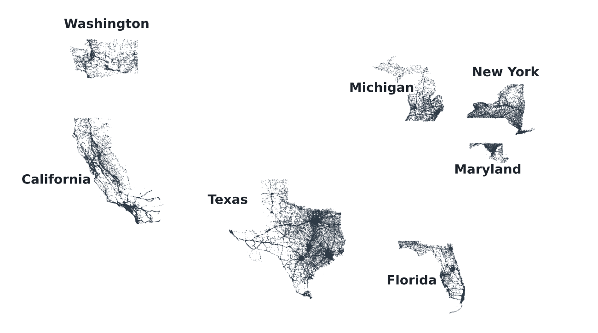
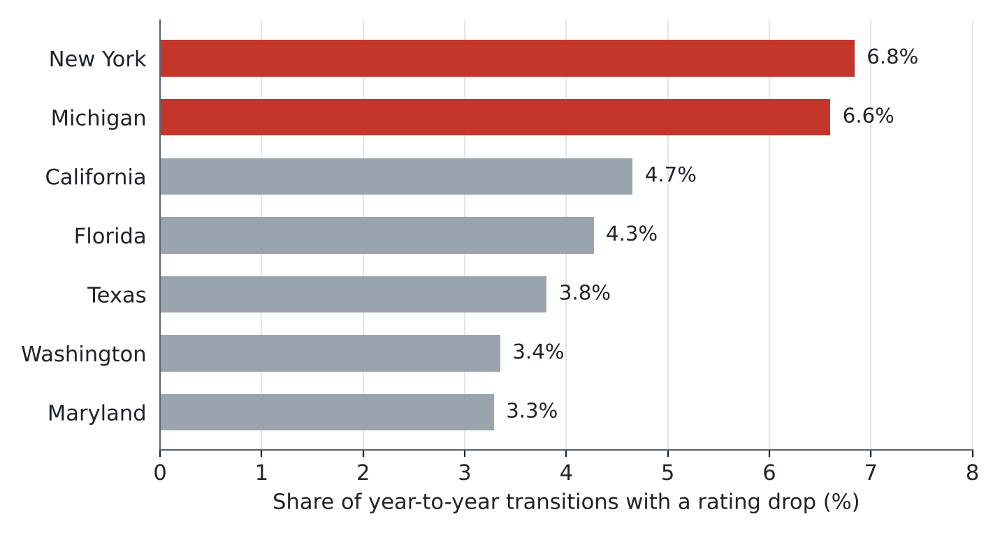
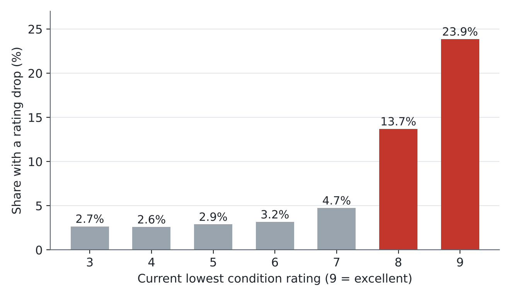
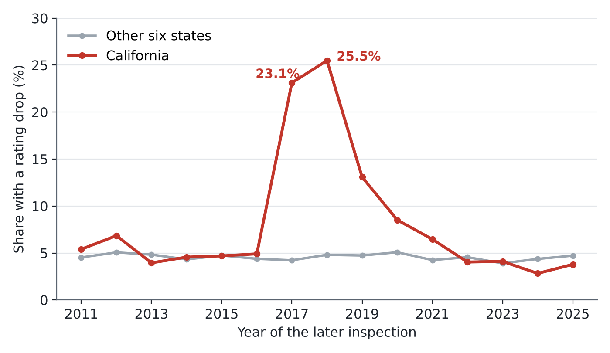
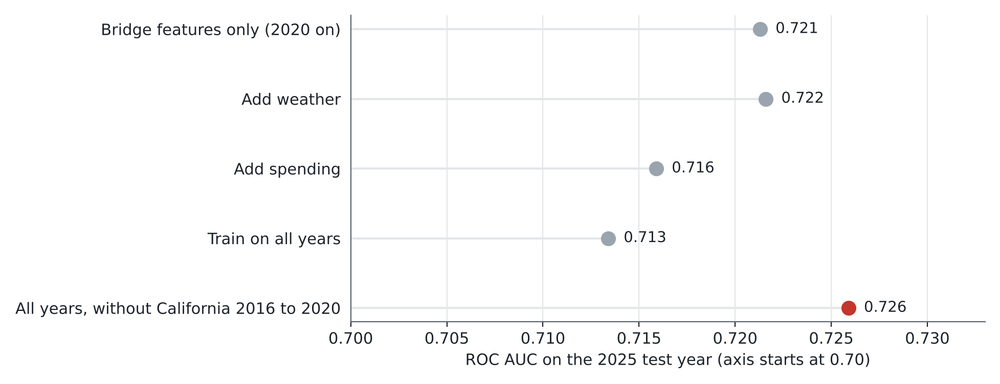
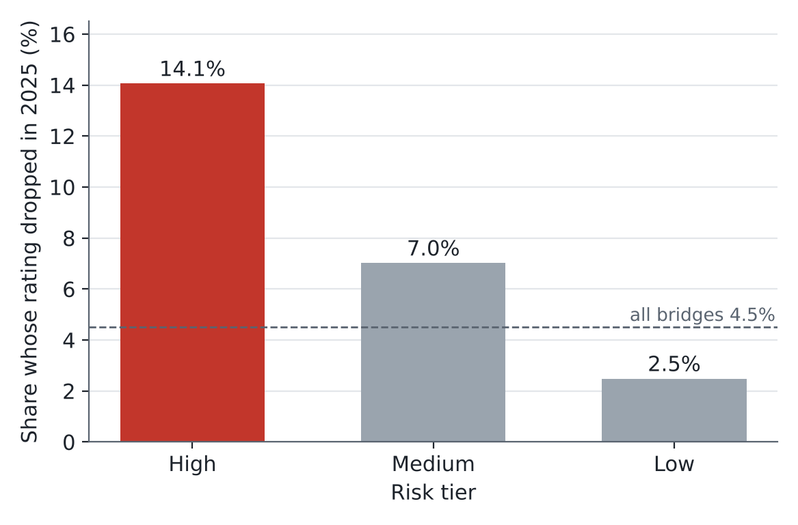
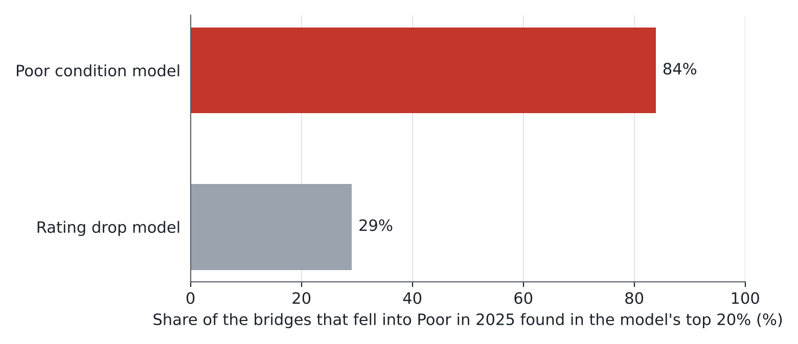

# BridgeWatch AI: Predicting Bridge Condition Deterioration from Federal Inspection Records

Edmund L. Goldsberry, UMBC Data Science Master's Degree Capstone, Fall 2026

Prepared for Dr. Chaojie (Jay) Wang

- YouTube video: [YouTube link]
- Presentation: https://github.com/goldiemonster/UMBC-DATA606-Capstone/blob/main/docs/capstone.pptx
- GitHub repository: https://github.com/goldiemonster/UMBC-DATA606-Capstone
- LinkedIn: [LinkedIn link]

## 1. Background

Every highway bridge in the United States is inspected about every one to two years under the National Bridge Inspection Standards, and the results go to the Federal Highway Administration (FHWA) in a public file called the National Bridge Inventory (NBI). A record describes one bridge: its age, design, traffic, and condition ratings on a scale from 0 (failed) to 9 (excellent). FHWA calls a bridge Good if its lowest rating is 7 to 9, Fair if it is 5 or 6, and Poor if it is 4 or below.

States cannot re-inspect or repair every bridge every year. The 2021 Infrastructure Investment and Jobs Act highlighted how much of the inventory is aging past its design life, and budgets stay limited. If the records can show which bridges are likely to decline before the next inspection finds out, planners could direct money by risk and not by a fixed schedule.

I set four research questions:

1. Can a machine learning model predict whether a bridge's condition rating will drop by its next inspection, using only what is known at the current inspection?
2. Which factors predict a drop best: age, traffic and truck loading, construction material, scour vulnerability, or time since the last inspection?
3. Does risk vary by state in a way that points to climate, beyond what a bridge's own attributes explain?
4. Is a state's spending on bridge repair related to how fast its bridges decline, and does adding it improve the predictions?

The finished tool is a screening aid. It flags bridges for a closer look and does not replace an inspector. It says nothing about whether a bridge is safe, and it does not predict collapse.

## 2. Data

### 2.1 Data sources

The main source is the FHWA National Bridge Inventory, published each year as one text file per state. Its fields follow FHWA's Recording and Coding Guide, and each column name carries its NBI item number (`YEAR_BUILT_027` is Item 27). I used seven states chosen for their range of climate and size: Michigan and New York (cold winters), Florida and Texas (heat and humidity), California and Washington (the West Coast), and Maryland (the Mid-Atlantic). With 16 yearly snapshots from 2010 to 2025, that makes 112 raw files.

Weather comes from NOAA's nClimGrid-Daily, a gridded product with daily temperature and precipitation at about 5 km resolution for the contiguous United States. I matched each bridge to its nearest grid cell and summarized each year into five values (see 2.4). It serves research question 3.

Spending comes from FHWA Highway Statistics Table SF-12A, which reports what each state highway agency spent on capital projects by type of improvement, in thousands of dollars. Each year's workbook has 14 sheets, one per road system and area. I summed the bridge columns across all of them for 2020 to 2024. It serves research question 4.

### 2.2 Size, shape, and time period

| Table | Files | Rows | Columns | Size | Time period |
|---|---|---|---|---|---|
| Raw bridge inventory | 112 | 2,147,605 | 123 to 137 | about 933 MB | 2010 to 2025 |
| Model-ready transitions | 15 | 1,985,801 | 39 | about 77 MB compressed | 2010 to 2011 through 2024 to 2025 |
| Weather | 16 | 2,146,854 | 8 | about 9 MB per file | 2010 to 2025 |
| State spending | 1 | 35 | 7 | under 2 KB | 2020 to 2024 |
| Current snapshot (used by the app) | 1 | 139,079 | 30 | about 6 MB compressed | 2025 |

The bridge and weather data give 15 year-to-year transitions per state. Spending exists only for 2020 to 2024, so the spending experiments cover the 681,841 transitions that start in 2020 or later. State sizes differ widely: Texas holds 41% of the 2025 bridges, and Maryland, the smallest, has 5,500.

### 2.3 What each row represents

| Table | One row is |
|---|---|
| Raw bridge inventory | One bridge, as one state recorded it in one year |
| Model-ready transitions | One bridge's move from one annual record to the next, such as its 2022 record and whether its rating dropped by 2023. A bridge adds up to 15 rows. |
| Weather | One bridge in one calendar year |
| State spending | One state in one year |
| Current snapshot | One bridge's 2025 record, joined with its 2025 weather |

### 2.4 Data dictionary

| Column | Type | Definition | Possible values |
|---|---|---|---|
| `STRUCTURE_NUMBER_008` | text | Bridge identifier, unique only within a state | Codes assigned by the state |
| `STATE` | category | State, taken from the file name | CA, FL, MD, MI, NY, TX, WA |
| `YEAR_BUILT_027` | integer | Year the bridge was built | For example 1937 to 2025 |
| `age` | integer | Inspection year minus year built (derived) | 0 to 225 |
| `ADT_029` | integer | Average daily traffic | 0 to 810,110 |
| `PERCENT_ADT_TRUCK_109` | float | Share of daily traffic that is trucks | 0 to 100 |
| `STRUCTURE_KIND_043A` | category | Main material and design | 0 other; 1 and 2 concrete; 3 and 4 steel; 5 and 6 prestressed concrete; 7 wood; 8 masonry; 9 aluminum or iron |
| `STRUCTURE_TYPE_043B` | category | Structure type | Codes from the Recording and Coding Guide |
| `MAIN_UNIT_SPANS_045` | integer | Spans in the main unit | 1 or more |
| `STRUCTURE_LEN_MT_049` | float | Length, in meters | Above 0 |
| `DECK_WIDTH_MT_052` | float | Deck width, in meters | Above 0 |
| `TRAFFIC_LANES_ON_028A` | integer | Traffic lanes on the structure | 0 or more |
| `DECK_STRUCTURE_TYPE_107` | category | Deck type | Codes from the guide |
| `SCOUR_CRITICAL_113` | category | Vulnerability to being washed out by water | N, U, 0 to 9 |
| `OWNER_022` | category | Owning agency | Codes from the guide |
| `INSPECT_FREQ_MONTHS_091` | integer | Months between required inspections | Usually 12 to 48 |
| `lat`, `lon` | float | Location, decoded from the packed `LAT_016` and `LONG_017` | Decimal degrees |
| `DECK_COND_058`, `SUPERSTRUCTURE_COND_059`, `SUBSTRUCTURE_COND_060`, `CULVERT_COND_062` | category | Component ratings. Culverts have only the culvert rating; other bridges have the other three. | N (not applicable), or 0 (failed) to 9 (excellent) |
| `LOWEST_RATING` | integer | Lowest of the component ratings that apply. FHWA publishes it from 2019; I rebuilt it for 2010 to 2018. | 0 to 9 |
| `BRIDGE_CONDITION` | category | Condition rollup, built from the lowest rating (same note) | G (7 to 9), F (5 or 6), P (4 or below) |
| `tmax_mean_c`, `tmin_mean_c`, `tavg_mean_c` | float | Annual mean of the daily maximum, minimum, and average temperature | Degrees Celsius |
| `prcp_total_mm` | float | Annual total precipitation | Millimeters, 0 or more |
| `freeze_thaw_days` | integer | Days when the high was above 0 C and the low below 0 C | 0 to 365 |
| `bridge_replacement_thousands`, `major_bridge_rehab_thousands`, `minor_bridge_rehab_thousands` | float | A state's yearly spending on replacing bridges and on major and minor rehabilitation | Thousands of dollars |
| `bridge_repair_total_thousands` | float | The three columns above added together | Thousands of dollars |
| `new_bridge_thousands` | float | Spending on new bridges, kept out of the repair total | Thousands of dollars |
| `deteriorated_next_period` | integer | Target. 1 if the lowest rating at the next inspection is lower than now | 0 or 1 |
| `falls_into_poor` | integer | Second target, defined only when `LOWEST_RATING` is 5 or higher. 1 if the next rating is 4 or below | 0 or 1 |
| `from_year`, `to_year` | integer | First and second year of a transition | 2010 to 2025 |

### 2.5 Target and features

The first target, `deteriorated_next_period`, comes from pairing each bridge's record in one year with its record the next year. It is 1 if the lowest rating went down. Of 1,985,801 transitions, 104,201 (5.25%) are drops, about 18 stable bridges for every one that dropped. A model that always answers "no drop" would be about 95% accurate and find nothing.

The second target, `falls_into_poor`, exists only for the 1,886,465 transitions that start with a lowest rating of 5 or higher, since a Poor bridge cannot fall into Poor. Of those, 13,109 (0.69%) end in Poor. The risk sits close to the line: 3.0% for a bridge rated 5, 0.46% for one rated 6, and 0.15% or less for one rated 7 or higher.

The models use 26 features, 10 categorical and 16 numeric: the lowest rating and the four component ratings; age and design (material, structure type, deck type, spans, length, width); use (traffic, truck share, lanes, inspection interval); scour rating, owner, and state; latitude and longitude; and five weather values. Current condition is a fair feature because it is known at forecast time. I left out the structure number, year built (replaced by age), `BRIDGE_CONDITION` (a coarse summary of the same ratings), and the year columns. I also tested spending per bridge, a state's repair total divided by its bridge count, and dropped it because it made predictions worse (Section 4).

## 3. Exploratory Data Analysis

The 112 raw files come in four layouts, with 134 columns (2010 to 2015), 135 (2016), 137 (2017 and 2018), and 123 (2019 to 2025). Every column the project needs is in all of them except `LOWEST_RATING` and `BRIDGE_CONDITION`, which FHWA publishes only from 2019. I rebuilt both for 2010 to 2018 from the four component ratings, using FHWA's rule. On the 959,519 records from 2019 to 2025, the rebuilt values differ from FHWA's published ones in zero rows, and the share of Poor bridges shows no jump at the changeover (4.78% in 2018, 4.81% in 2019).

Other problems were smaller. `TX18.txt` is not valid UTF-8, so I read every file as `latin-1`. Eight files repeat a structure number, 23 in all. None of the repeats is an exact copy and I could not tell which record in a pair is right, so I dropped all 46 rows. Michigan's 2010 file numbers its bridges differently from every later year, so only 80 of its 10,928 bridges match the 2011 file, which costs about 11,000 transitions (0.5%). Elsewhere 98.6% to 99.9% of bridges keep their number from year to year.

Most missing values are by design: a culvert has only a culvert rating, and other bridges have the other three. The one predictor with real gaps is truck share, missing for about 13% of bridges in 2010 to 2017 and 1.7% from 2018 on, almost all of it in Texas. The model fills it with the median. The code columns also mean the same thing before and after FHWA's 2019 format change (the largest shift in a code's share is 5 points), so I modeled all years together.

Latitude and longitude come as packed integers, so `40454199` means 40 degrees, 45 minutes, 41.99 seconds. After decoding, I checked each point against its state's bounding box. In the 2025 file, 10 coordinates were blank, 146 landed outside their state (some were placeholder codes), and 370 used a different number format. I set these to missing, which left 156 of 139,079 bridges (0.11%) without a usable location, because a wrong location on a risk map is worse than none. Filling a missing coordinate from the same bridge's other years cut the transition rows without a location from 27,552 to 595 of 1,985,801 (Figure 1).



*Figure 1. Every bridge in the 2025 snapshot with a usable location, 139,026 of 139,079.*

In the 2025 snapshot, median age is 50 years and traffic is heavily skewed.

| Variable (2025) | Mean | Median | Minimum | Maximum |
|---|---|---|---|---|
| Age (years) | 48.1 | 50 | 0 | 225 |
| Average daily traffic (vehicles) | 14,638 | 3,400 | 0 | 810,110 |

By condition, 46.7% of bridges are Good, 49.0% are Fair, and 4.3% are Poor. Poor is far more common in Michigan (11.0%) and New York (9.9%) than in Texas (1.2%). Five bridges have an age above 200 and 684 (0.49%) report zero traffic; I kept them as rare but plausible.

I built the target on `LOWEST_RATING` because it is complete for every bridge and moves in finer steps than the three-level condition. Drop rates differ by state (Figure 2): Michigan and New York run at about twice the rate of Maryland and Washington. Some state and year combinations are too sudden to be wear. Michigan is at about 1% in the transitions ending 2011 and 2012 against 6% to 9% later, Washington is at about 1% in 2011 and 2021, and New York's 2025 rate, in my test year, is 11.0%, about double its recent level. These look like differences in when and how states update ratings.



*Figure 2. Share of year-to-year transitions with a rating drop, by state, 2010 to 2025, leaving out California's 2016 to 2020 transitions (see Figure 4).*

The rating itself held a surprise: bridges rated 8 or 9 drop far more often than bridges in the middle of the scale (Figure 3). A bridge rated 9 can only stay or fall, and new or freshly repaired bridges tend to settle from 9 to 8. Bridges already rated low rarely drop further, partly because there is little room left and partly because they tend to be repaired or closed. My label counts any one-point drop, so 9 to 8 counts the same as 4 to 3, and the score is the chance of a rating drop and not of a bridge becoming unsafe. That distinction led to the second model.



*Figure 3. Share of transitions with a rating drop, by the bridge's current lowest rating, 2010 to 2025.*

California is the largest oddity (Figure 4). About a quarter of its ratings went up in 2016. Then 23.1% of its bridges dropped in the transitions ending 2017, 25.5% in 2018, and 13.1% in 2019, while the other six states stayed near 4% to 5%. A wave of upgrades followed by a wave of downgrades looks more like a change in how ratings were assigned than thousands of bridges wearing out together. I cannot prove the cause, but training on those years made the model worse (Section 4), so I kept the rows in the processed dataset and left California's transitions ending 2016 to 2020 out of training.



*Figure 4. Share of bridges whose rating dropped, California against the other six states, by the year of the later inspection.*

In the weather data, all five values are blank together for about 1.4% of bridges, those whose nearest grid cell falls just offshore. Climate differs sharply by state: Michigan and New York average about 90 freeze and thaw days a year, and Florida 4.5. Two mistakes surfaced when I joined weather to the bridges. My row-count check failed first. A structure number is unique only within a state, and in 2010 one number belongs to both a Michigan bridge and a Texas bridge, so one bridge picked up two weather rows. I changed every join to use the structure number, the state, and the year together, and 98.6% of transition rows now find their weather. The second mistake was in my first weather files, which stored a missing grid cell as zero rainfall and zero freeze and thaw days. I rebuilt all 16 years with a corrected script and left missing values blank.

Spending needed care too. The rural interstate sheet holds only about 6% of the bridge repair money, and using it alone would have made Washington look like it spent nothing from 2020 to 2023, so I summed all 14 sheets. Raw dollars mostly track how many bridges a state has, so I divided each state's repair total by its bridge count. Michigan and New York spend the most per bridge (roughly $39,000 to $67,000 a year) and California the least (about $8,000 to $16,000). Across the seven states, spending per bridge and the rate of rating drops correlate at about +0.60, but within a state over time the link is about -0.13. The across-state link probably runs from condition to spending, since those two states have harsh winters and more bridges in poor shape, so I would not read it as spending causing decline.

## 4. Model Training and Results

I used Logistic Regression for both models. Each feature gets one coefficient showing whether it raises or lowers risk, and the app has to explain every score in those terms. It is also a standard baseline that a more flexible model would have to beat to justify being harder to read. I did not try one here (see 6.4).

Preprocessing and model sit in one scikit-learn Pipeline fit on training data only, so nothing about the test year leaks into it. Numeric features get median fill and scaling, and categorical features get most-frequent fill and one-hot encoding, which turns 26 features into 154 columns. The model uses `class_weight="balanced"` so the rare drops count more, and `max_iter=1000`. I ran the notebooks in [development environment] with pandas, NumPy, scikit-learn 1.9.1, Plotly, joblib, and Streamlit (see `requirements.txt`).

The split is by time. The model trains on every transition ending before 2025 and is tested on the 137,920 transitions ending in 2025, of which 6,268 (4.5%) are drops. This matches real use, forecasting next year's risk for bridges already being tracked. A bridge can appear in both sets, but the model never sees its 2025 outcome. I used 2024 as a validation year to choose how much history to train on, which kept the 2025 test set out of that choice.

I scored models three ways. ROC AUC is the chance that a bridge that really dropped scores higher than one that did not, so 0.5 is a random ranking. Average precision is the area under the precision and recall curve, and a random ranking scores the share of positives (0.045 here). The capture rate is the share of the bridges that really dropped found in the top 5%, 10%, or 20% of the ranking. I did not use accuracy. To compare versions, I redrew the test set 200 times and counted a difference only if the middle 95% of the redraws stayed on one side of zero.

I added one thing at a time and compared each version on the 2025 test year.

| Stage | What I tried | Test ROC AUC | Outcome |
|---|---|---|---|
| Starting point | Bridge features only, trained on 2020 onward | 0.721 | Baseline |
| Add weather | Temperature, precipitation, and freeze and thaw days | 0.722 | No clear gain, no harm, kept |
| Add spending | Repair spending per bridge | 0.716 | Made predictions worse, dropped |
| Train on all years | Add the 2010 to 2019 transitions | 0.713 | Worse, because of California's rating swing |
| Leave out California 2016 to 2020 | All years except those California transitions | 0.726 | Best, used for the app |



*Figure 5. ROC AUC on the 2025 test year at each stage. The axis starts at 0.70.*

Weather first looked like a small gain. That was before I found the zero-filled weather files described in Section 3. With corrected weather the change in ROC AUC is +0.0003, and the middle 95% of the redraws runs from -0.0003 to +0.0009, so it cannot be told apart from luck.

Spending made the model worse by 0.0057, with the whole 95% range below zero. In the training years, a state that spent more than usual had slightly more deterioration (a correlation of +0.21), so the model learned that more spending means more risk. In 2024 that reversed: New York spent about $15,000 less per bridge than usual and its rate of drops rose 5.4 points, while Michigan spent about $13,500 more and its rate fell 1.4 points. With only 28 distinct spending values to learn from, the model could not find a pattern that holds across years.

I compared three training histories on the 2024 validation year.

| Training history | Training rows | Validation ROC AUC (2024) | Test ROC AUC (2025) |
|---|---|---|---|
| All years | 1,710,725 | 0.6868 | 0.7134 |
| All years without California 2016 to 2020 | 1,583,562 | 0.7025 | 0.7259 |
| 2020 onward only | 406,765 | 0.7024 | 0.7216 |

Training rows are for the validation run. Using all years was clearly worst. Leaving out California's swing matched the 2020 onward model on validation with almost four times as much data. I counted scores within 0.001 as a tie and gave ties to the larger training set, so the final model trains on all years without California's 2016 to 2020 transitions (1,720,718 rows). On the test year it beats the 2020 onward model by about 0.004 (95% range +0.0025 to +0.0062) and the all-years model by about 0.013.

The final model has a ROC AUC of 0.726 and an average precision of 0.120. That is a useful ranking and not a sharp one: the top 20% of bridges contain half of the drops, and the other half fall outside it. The gain over simpler versions is small because a bridge's own rating does most of the work.

The raw scores cannot be shown as probabilities. They averaged 43.7% when only 4.5% of test bridges dropped, because balanced class weights push every score up. One fixed shift of -3.036 in the log odds, the log odds of a drop in the training data, removes the inflation and leaves the ranking untouched, so ROC AUC stays at 0.726. The Brier score falls from 0.210 to 0.042, and in the top tenth of bridges the corrected chance averages 12.9% against 14.1% that really dropped. Corrected chances run slightly low at the top, so the app calls them estimates.

I grouped bridges into tiers. High is the top 10% of 2025 test bridges by corrected chance, Medium the next 20%, and Low the rest. The cutoffs are corrected chances of 8.3% and 4.7%.

| Tier (first model) | Test bridges | Share of all drops | Share that dropped |
|---|---|---|---|
| High | 13,792 | 30.9% | 14.1% |
| Medium | 27,584 | 30.9% | 7.0% |
| Low | 96,544 | 38.2% | 2.5% |



*Figure 6. Share of 2025 test bridges whose rating dropped, by risk tier of the first model.*

The coefficients answer question 2. Current condition is by far the strongest predictor: one standard deviation of `LOWEST_RATING` (about one rating point) multiplies the odds of a drop by 3.4, which sounds backwards until you recall that bridges rated 8 or 9 drop most. A culvert rated 3 has about 13 times the odds of a further drop, and age adds about 18% to the odds for every 25 years. Traffic, truck share, and lane count all sit within 2% of 1.0. Washington has about 0.6 times the odds of the other states once everything else is accounted for, and California, New York, and Michigan about 1.4 times. The three temperature columns correlate at 0.94 to 0.98 and share their effect, so I judged weather by adding and removing all five at once.

The first model's High tier is mostly bridges rated 8 or 9: 99.9% of the bridges rated 9 in the 2025 snapshot are High, and so are 75% of those rated 8. That answers the question the model was trained on, but a planner may care more about which bridges are about to become Poor. On that question the first model has a ROC AUC of 0.547, barely better than a coin flip, and its top 20% contain only 29% of the bridges that fell into Poor.

So I built a second model with the same features, algorithm, time-based split, validation method, and tiers. It scores only bridges rated above 4. Its 2025 test set has 131,831 bridges, 726 of which (0.55%) fell into Poor, and it trains on 1,635,415 rows. Validation again favored all years without California's 2016 to 2020 transitions (ROC AUC 0.868, against 0.861 for all years and 0.865 for 2020 onward). On the test year its ROC AUC is 0.89 (0.8916) and its average precision is 0.047, about nine times a random ranking's 0.0055.

A rare event needs a different correction. The fixed shift left the top scores too high: for the 130 highest scoring bridges it predicted 36% when 13.8% really fell into Poor. I fitted a slope (0.759) and an intercept (-5.319) on the validation year instead, using scores from a model that had not seen 2024. The same 130 bridges are then predicted at 13.8% against 13.8% real. The lowest groups still run a little high and the top group a little low (2.6% predicted against 3.25% real).

The table below sets the two models side by side on what each was built to find.

| Top share of the ranking | 5% | 10% | 20% | 30% | 50% |
|---|---|---|---|---|---|
| Rating drops found (first model) | 18.6% | 30.9% | 50.3% | 61.8% | 79.1% |
| Bridges that fell into Poor found (second model) | 39.1% | 59.0% | 83.9% | 93.7% | 98.2% |

| Tier (second model) | Test bridges | Share of all that fell into Poor | Share that fell into Poor |
|---|---|---|---|
| High | 13,184 | 59.0% | 3.25% |
| Medium | 26,366 | 34.7% | 0.96% |
| Low | 92,281 | 6.3% | 0.05% |



*Figure 7. Share of the bridges that fell into Poor in 2025 found in each model's top 20%.*

The second model is mostly about distance from the line: each rating point above the current level cuts the odds of falling into Poor by more than half, and a culvert rated 5 has about 3.7 times the odds. California bridges have about 3.4 times the odds and Maryland bridges about a third. Its High tier is 97% bridges rated 5, ranked by the other facts about them. Some of its largest coefficients belong to rare categories, such as a scour critical rating of 2 (a multiplier near 19), so I trust those less. Only 0.7% of the bridges above Poor are High in both models, and 6.9% are High for falling into Poor but Low for a rating drop, which is why the app offers both.

In short, the ranking scores answer research question 1, the coefficients answer question 2, and the with-and-without comparisons answer question 3 (weather) and question 4 (spending).

## 5. Application of the Trained Models

I saved both models with joblib in `app/model/` (about 19 KB each), with their feature lists, score corrections, tier cutoffs, test scores, and library versions. `scripts/build_current_risk_snapshot.py` builds a table of every bridge's 2025 record joined with its 2025 weather (139,079 bridges), so the app never reads the raw files. `app/scoring.py` scores bridges and explains each score. Because the model is linear, each feature's contribution is its coefficient times its value, and the contributions add up exactly to the model's score. A fresh Python process gives identical scores from the saved files.

The Streamlit app has three pages. Home describes the project and shows the two views side by side, with how each tier performed in 2025. Bridge Lookup lets a user pick a state and search by structure number, road, or place. It shows both models' chance and tier, the bridge's key facts, the biggest reasons behind the score, the state's 2024 repair spending per bridge as background, and a small map. State Risk Map draws a state's bridges colored by tier, with a tier filter and a table of the 20 highest scoring bridges. A sidebar switch moves every page between the two views of risk, and a bridge that is already Poor shows as "Already Poor" in the second view. A map background choice (OpenStreetMap, CARTO, or plain) covers networks that block the street maps.

The app tells users how to read a score. The chance is an estimate, and the models rank bridges better than they predict any single one. A rating drop is not a failure, and High in the first view mostly means a bridge rated 8 or 9. Poor is the federal term for a lowest rating of 4 or below and does not mean unsafe. The app does not predict collapse or tell anyone to close a bridge.

I tested the app with 43 automated checks across both views and all seven states, including a bridge that is already Poor, a bridge with no coordinates, and a search with no matches, and I confirmed that a bridge gets the same score on every page. Running the real app in a browser then turned up problems the checks could not see: cut-off tables, tiny rates displayed as 0.0%, and a map with no street map behind the bridges.

To run it, install the packages and start it from the project folder:

```
pip install -r requirements.txt
streamlit run app/app.py
```

The saved models need scikit-learn 1.9.1. If the app cannot load them on another machine, rerun `notebooks/model_training_step_11.ipynb` to save them with the installed version.

[Screenshot: Home page showing the two risk views]

[Screenshot: Bridge Lookup page for one bridge]

[Screenshot: State Risk Map for one state]

## 6. Conclusion

### 6.1 Summary and possible uses

I built two Logistic Regression models from 16 years of federal bridge inspection records, weather, and state spending, and put them in a Streamlit app that scores 139,079 bridges. One estimates the chance that a bridge's lowest rating drops by its next inspection; the other estimates the chance that a bridge not yet Poor falls into Poor.

Research question 1. A model can rank bridges by risk of a rating drop, but not sharply: the first model's ROC AUC is 0.726 on the 2025 test year, and its top 20% of bridges contain half of the drops. Falling into Poor is easier to rank (ROC AUC 0.89, with 84% of those bridges in the top 20%), partly because a bridge rated 5 is close to the line.

Research question 2. Current condition is the strongest predictor by far, followed by age. Traffic, size, and weather matter much less. Because bridges rated 8 or 9 drop most often, part of the first model's signal reflects how the label is defined as much as how bridges wear.

Research question 3. Weather added no clear improvement once the bridge's own features and its state were known (+0.0003 in ROC AUC, within the range of luck). States still differ, with Washington lowest and California, New York, and Michigan highest. That does not show climate has no physical effect, only that weather added no reliable information beyond what the state already carries.

Research question 4. Spending per bridge made predictions worse. Across states, higher spenders also have more deterioration, most likely because states spend where bridges are already in poor shape, so I would not read it as spending causing decline.

The scores suit a screening role: a planner could use the High tier of either view to decide which bridges to look at sooner, and Bridge Lookup shows the reasons for each score so they can be checked against what is known about the structure.

### 6.2 Limitations

The label counts any one-point drop the same, so the first model's score is a chance of a rating drop and not a chance of an unsafe bridge. The second model answers part of that, but it tests only one threshold.

Ratings are human judgments and can shift for reasons that have nothing to do with the bridge. California's 2016 to 2020 swing is the clearest case, and Michigan, Washington, and New York have unusual years as well. New York's 2025 rate, in my test year, is about double its recent level, and the test results include that jump.

The project covers seven states, not the country. Spending covers only 2020 to 2024 (35 values) and is not adjusted for inflation. Michigan's 2010 transitions are mostly missing, and older Texas records lack a truck share. The corrected chances are estimates that run a little low at the top of each ranking, and a state's share of bridges in each tier comes from the model, not from a rule. All the associations are correlations, and none shows that weather or spending causes deterioration.

### 6.3 Lessons learned

More data helped only after I understood it. The 2010 to 2019 years made the model worse until I found what was wrong with California, and then they made it better.

My first answers were not final. The small weather gain I first saw came from my own faulty weather files and disappeared when I fixed them, so I now recheck earlier conclusions whenever the data changes.

I chose the training history on a validation year, so the test year stayed out of that choice. The weather and spending comparisons did use the test year, which makes those two results a little less clean.

A failing check is useful. The Michigan and Texas join problem surfaced only because I asserted that a join must not change the row count.

A model has to answer the question people ask. The first model answered the question I gave it, but its High tier was mostly bridges rated 8 or 9, which may not be what a planner means by risk. The second model, and an app that says what each score means, made the project more useful.

### 6.4 Future research

Spending is the weakest part. The SF-12A workbooks for 2010 to 2019 would give 105 state-year values instead of 35 and a fairer test of question 4, and adjusting the dollars for inflation would make years comparable.

Logistic Regression is my baseline. A more flexible model such as gradient boosting could be compared against it on the same split, and it would have to beat 0.726 by enough to justify being harder to explain. A label that weighs drops by how serious they are would address the any-drop limit more directly than a single Poor threshold.

More states would test whether the findings hold outside these seven, and a crosswalk for Michigan's 2010 bridge numbers would recover the lost transitions. When FHWA publishes the 2026 inventory, I can rebuild the snapshot and weather files and retrain to see how the results hold up on a new year. The cause of California's 2016 change is still open.

## 7. References

Federal Highway Administration. National Bridge Inventory, ASCII files. https://www.fhwa.dot.gov/bridge/nbi/ascii.cfm

Federal Highway Administration. Recording and Coding Guide for the Structure Inventory and Appraisal of the Nation's Bridges.

Code of Federal Regulations, Title 23, Part 650, Subpart C: National Bridge Inspection Standards.

NOAA National Centers for Environmental Information. nClimGrid-Daily. https://www.ncei.noaa.gov/products/land-based-station/nclimgrid-daily

Federal Highway Administration. Highway Statistics, Table SF-12A, State Highway Agency Capital Outlay. https://www.fhwa.dot.gov/policyinformation/statistics/2024/sf12a.cfm

pandas documentation. https://pandas.pydata.org/docs/

scikit-learn documentation. https://scikit-learn.org/stable/

Plotly documentation. https://plotly.com/python/

Streamlit documentation. https://docs.streamlit.io

OpenStreetMap contributors. Map data. https://www.openstreetmap.org/copyright

UMBC Data Science Capstone course repository, report template and requirements. https://github.com/wcj365/UMBC-Data-Science-Capstone
